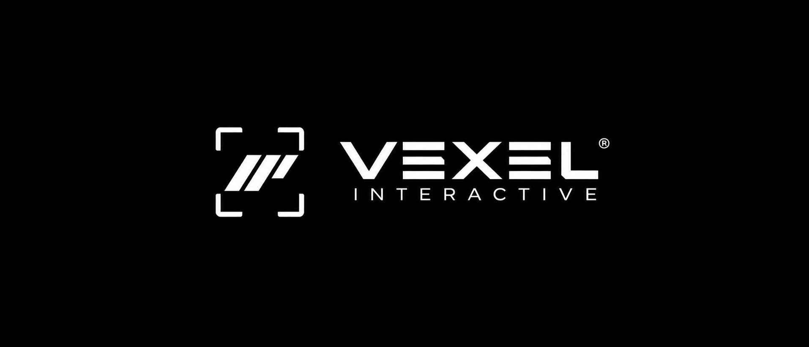

 
 

**REAL-TIME TECHNOLOGY · GAME ENGINES · INTERACTIVE WORLDS**

 

 

---

 

## ▍ About

**Vexel Interactive** is an independent studio building the technology behind modern, realistic, story-driven games: our own engine, our own tools, and the pipelines that connect them.

We care about three things: image quality, simulation fidelity, and a workflow that stays out of the creator's way.

 

---

 

## ▍ What We Build

<table>
  <tr>
    <td width="33%" valign="top">
      <h3>◢ ENGINE</h3>
      A modern C++ engine on DirectX 12, built around ray tracing, physically based rendering, and a simulation-first approach to physics, water, and destruction.
    </td>
    <td width="33%" valign="top">
      <h3>◢ TOOLS</h3>
      Authoring pipelines that put scene creation where artists already work, with fast iteration and stable hot reload.
    </td>
    <td width="33%" valign="top">
      <h3>◢ GAMES</h3>
      Atmospheric single-player experiences, built on top of our own technology from the first line of code.
    </td>
  </tr>
</table>

 

---

 

## ▍ Principles

|   |   |
|:--|:--|
| **Fidelity first** | Realistic light, materials, water, and destruction are the baseline, not a stretch goal. |
| **Graceful by design** | Advanced GPU features are optional. Hardware without them still runs the game. |
| **Own the stack** | Core systems are built and understood in-house, with proven libraries only where they earn their place. |
| **Tools that disappear** | The best editor is the one the creator never has to fight. |

 

---

 

## ▍ Status

Our repositories are currently private while the core technology matures.
Public releases, documentation, and tooling will appear here as they are ready.

 

---

 

**VEXEL INTERACTIVE**

`I N T E R A C T I V E`

© Vexel Interactive. All rights reserved.

